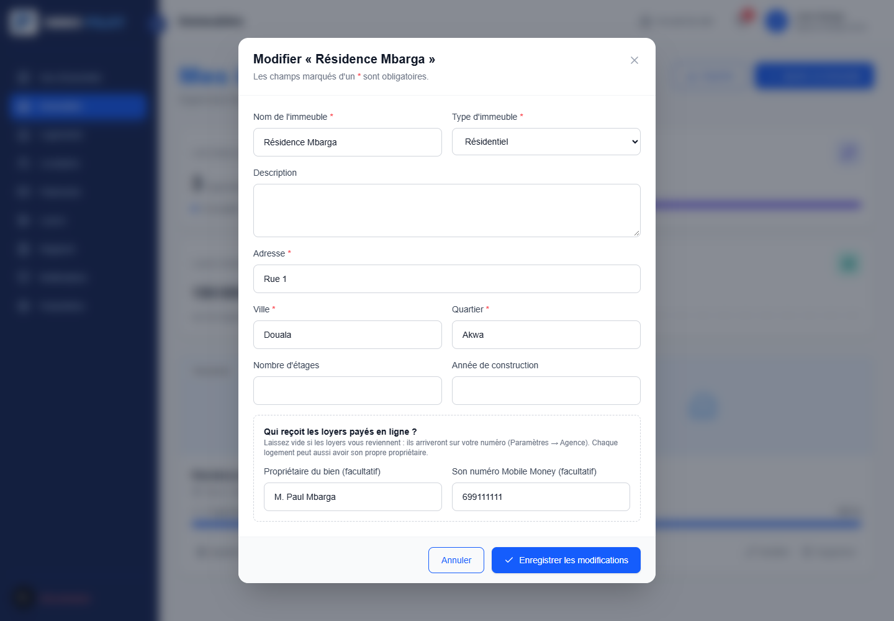

# IMMO PILOT

**Gestion locative pour les propriétaires et les agences au Cameroun** : immeubles, logements, locataires, loyers
et paiement des loyers par **Orange Money / MTN MoMo**.

> Paiements réels par SasPay (abonnements et loyers) ; en développement, un simulateur évite tout argent réel.

## Fonctionnalités

**Espace bailleur**
- Immeubles (avec photo) et logements : statut libre / occupé / en travaux, propriétaire de chaque bien
- Locataires : baux, attribution et changement de logement, historique des paiements
- Suivi des loyers mois par mois (payé, partiel, en retard) et relances par e-mail ou WhatsApp en un clic
- Tableau de bord, rapports sur 12 mois et exports CSV
- Abonnements Starter / Pro / Enterprise avec limites, essai gratuit et paiement Mobile Money (SasPay)

**Espace locataire (sans compte)**
- Lien personnel et secret pour payer son loyer depuis son téléphone
- L'argent va au propriétaire du logement, sinon de l'immeuble, sinon au bailleur

**E-mails automatiques (Brevo)** : bienvenue, lien de paiement du locataire, reçus de loyer, confirmation
d'abonnement avec facture, mot de passe oublié.

**Console super admin** : clients, abonnements et prolongations, utilisateurs, tickets de support, paramètres
de la plateforme (prix, essai, maintenance).

| Fiche d'un immeuble | Paiement du loyer par le locataire |
|---|---|
|  |  |

## Technologies

| Partie | Technologies |
|---|---|
| `frontend/` (site + espace bailleur + page locataire) | Next.js 16 (App Router, React 19), TypeScript, Tailwind CSS 4 |
| `superadmin/` (console d'administration) | Next.js 16, TypeScript, Tailwind CSS 4 |
| `backend/` (API) | ASP.NET Core 10, Entity Framework Core, PostgreSQL, JWT en cookie httpOnly |
| Services | SasPay (Mobile Money), Brevo (e-mails SMTP), Cloudinary (photos) |

```
Navigateur ──► frontend (Next.js)  ──/api/* (proxy)──►  API ASP.NET  ──►  PostgreSQL
Navigateur ──► superadmin (Next.js) ──/api/* (proxy)──►      │
                                                             ├──► SasPay / simulateur (paiements)
                                                             ├──► Brevo (e-mails, en arrière-plan)
                                                             └──► Cloudinary (photos)
```

Points d'architecture :
- **Sécurité** : session en cookie httpOnly `SameSite=Lax` ; le navigateur n'appelle que le domaine du site, Next
  transmet à l'API. Mots de passe hachés (PBKDF2), limitation des tentatives de connexion, sessions fermées après un
  changement de mot de passe, données isolées par bailleur.
- **Paiements** : confirmation atomique (webhook et vérification simultanés ne prolongent qu'une fois), tâche de fond
  qui revérifie les paiements en attente.
- **E-mails** : file d'attente en arrière-plan ; une panne de Brevo ne bloque ni une inscription ni un paiement.

## Lancer le projet en local

Prérequis : .NET 10, Node.js 20+, PostgreSQL.

```bash
# 1. API (http://localhost:5065) : voir backend/README.md pour les secrets (base, JWT, Brevo…)
cd backend/ImmoPilot.Api
dotnet run --launch-profile http

# 2. Site (http://localhost:3000)
cd frontend && npm install && npm run dev

# 3. Super admin (http://localhost:3001)
cd superadmin && npm install && npm run dev
```

## Lancer avec Docker (tout le projet en une commande)

```bash
cp .env.example .env        # puis remplir POSTGRES_PASSWORD, JWT_CLE, SUPERADMIN_MOT_DE_PASSE
docker compose up --build
```

| Service | Adresse |
|---|---|
| Site | http://localhost:3000 |
| Super admin | http://localhost:3001 |
| API | http://localhost:5065/api/offre |

Quatre conteneurs : `db` (PostgreSQL 17), `api` (`backend/Dockerfile`), `frontend` et `superadmin`
(`Dockerfile` Next.js « standalone »). Les tables sont créées au démarrage et le mode démo est activé.

## Mise en ligne (gratuite)

| Partie | Hébergeur conseillé |
|---|---|
| `frontend/` et `superadmin/` | Vercel (un projet chacun, « Root Directory » = le dossier) |
| `backend/` | Render ou Railway, avec le `backend/Dockerfile` |
| Base de données | Neon ou Supabase (PostgreSQL) |

**Variables d'environnement de l'API** (`__` remplace `:`) :

| Variable | Valeur |
|---|---|
| `ConnectionStrings__ImmoPilot` | l'adresse PostgreSQL telle que donnée par Neon / Supabase (`postgresql://…`) ou au format `Host=…;Database=…` |
| `Jwt__Cle` | clé aléatoire d'au moins 64 caractères |
| `Cors__Origines__0`, `Cors__Origines__1` | adresses du site et du super admin |
| `Frontend__Url` | adresse du site (liens des e-mails) |
| `Base__MigrerAuDemarrage` | `true` (crée / met à jour les tables au démarrage) |
| `ForwardedHeaders__FaireConfianceAuxProxys` | `true` (HTTPS et IP des visiteurs derrière le proxy de l'hébergeur) |
| `Demo__Actif` | `true` (paiements simulés, aucun argent réel) ; à retirer pour encaisser avec SasPay |
| `Saspay__CleApi` | clé secrète SasPay (tableau de bord → Développeur) : `sk_test_…` pour tester, `sk_live_…` pour l'argent réel |
| `Saspay__SecretWebhook` | secret de signature du webhook SasPay (affiché une seule fois à sa création) |
| `SuperAdmin__Email`, `SuperAdmin__MotDePasse` | compte super admin (mot de passe de 12 caractères minimum) |
| `SuperAdmin__Reinitialiser` | `true` le temps d'un redémarrage pour remplacer l'e-mail et le mot de passe du super admin existant (puis retirer) |
| `SuperAdmin__FrontendUrl` | adresse du super admin (lien « mot de passe oublié ») |
| `Email__BrevoApiKey`, `Email__Expediteur`, `Email__NomExpediteur` | e-mails via l'API de Brevo (HTTPS) : **obligatoire sur Render gratuit**, qui bloque les ports SMTP |
| `Email__Hote`, `Email__Port`, `Email__Utilisateur`, `Email__MotDePasse` | ou bien SMTP (ignoré si `Email__BrevoApiKey` est renseignée) |
| `Cloudinary__CloudName`, `Cloudinary__ApiKey`, `Cloudinary__ApiSecret` | photos des immeubles |

**Variables des deux projets Next.js (Vercel)** :

| Variable | Valeur |
|---|---|
| `API_URL` | adresse de l'API, ex. `https://immopilot-api.onrender.com` |
| `NEXT_PUBLIC_SITE_URL` | adresse du site (frontend uniquement) |
| `NEXT_PUBLIC_MODE_DEMO` | `true` : badge « Démo · aucun paiement réel » (frontend) |
| `NEXT_PUBLIC_EMAIL_CONTACT` | facultatif : adresse de contact affichée dans les pages légales |

> Les hébergeurs gratuits mettent l'API en veille : le premier chargement après une pause peut prendre ~30 s.
